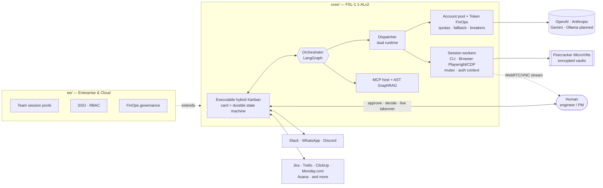

# Tradvia

**The open-core AgentOps & hybrid execution control plane.**
Orchestrate humans, multi-model APIs and isolated container sessions in a single control plane.

> 🚧 Pre-alpha, building in public. Every capability below carries its real status.
> **[Join the waitlist for the managed Cloud / Enterprise edition →](#waitlist)**
> · Website: [tradvia.org](https://tradvia.org)

[](https://codespaces.new/Tradvia/tradvia)

---

## Why

Tradvia removes the coordination friction between project management and
autonomous execution. Instead of isolated chat prompts, work is dispatched as
cards on a hybrid Kanban, routed to the right runtime — a multi-vendor API pool
or a stateful browser/CLI container — tracked to the token and the compute
second, and handed back and forth between AI agents and human engineers
without losing context.

## Architecture pillars

| # | Pillar | What it means | Status |
|---|---|---|---|
| 1 | **Dual-runtime execution** | Stateless LLM APIs (OpenAI, Anthropic, Gemini; Ollama is 🗓️ Planned) side by side with stateful **session workers**: containers running authenticated CLI tools or browser sessions (Playwright/CDP), guarded by session mutex locks and persistent auth contexts. | 🟦 Partial — APIs via LiteLLM |
| 2 | **Multi-account pool & Token FinOps** | Pool accounts across vendors, spread load **within each account's RPM/TPM quota**, fall back across vendors when one is saturated or down, and record exact cost per token or per compute second on the card, with budget circuit breakers. | 🟦 Partial — cost per card, per-card execution budgets |
| 3 | **Executable hybrid Kanban & Live Session Takeover** | Every card is a durable state machine. On a blocker (2FA, CAPTCHA, complex UI, architecture decision) Tradvia freezes the session, alerts a human on Slack/WhatsApp and streams the terminal or browser (WebRTC/VNC) so they can resolve it and hand control back. | 🔨 In progress — state machine + approval in chat |
| 4 | **Zero-trust sandbox** | Ephemeral Firecracker MicroVMs per execution and session, PostgreSQL Row-Level Security, encrypted credential and session vaults. | 🗓️ Planned |
| 5 | **Native MCP & AST GraphRAG** | Plug-and-play MCP tools; AST-based code indexing with episodic knowledge distillation to cut token cost over time. | 🔨 In progress — MCP for agents (stdio and HTTP), tested offline; AST GraphRAG 🗓️ Planned ([docs/mcp.md](docs/mcp.md)) |
| 6 | **Open-core monorepo** | Self-hosted `/core` via Docker Compose; `/ee` + Cloud with team session pools, RBAC and FinOps governance. | 🔨 In progress — monorepo, licenses, CI |

**Ground rules.** The account pool respects each vendor's rate limits and
terms; it never tries to bypass them. Session workers only operate accounts
and portals the customer is authorized to use, and 2FA or CAPTCHA prompts are
always resolved by a human through Live Session Takeover.

See [ADR 0003](docs/adr/0003-agentops-hybrid-execution-control-plane.md).

**Review, merge and deploy from the dashboard** (ADR 0007): the card shows the
pull request (executor summary and cost, changed files with a per-file diff,
the `core-tests`, `license-boundary` and `cla` checks, review comments), and a
maintainer can squash-merge it, update its branch, approve or reject pending
`production` deploys, cancel replaced ones and run the post-deploy operation,
always with their own GitHub token and an audit entry. Status: 🟦 Partial,
tested offline; it works in production once the GitHub App has the new
permissions ([docs/github-app.md](docs/github-app.md)).

**Orchestrator conversation** (ADR 0007): each project has a chat in the
dashboard where an orchestrator agent reads the backlog, cards, plans, pull
requests, checks and deploys, creates and edits cards, orders the backlog,
starts cards, answers plans with an adjustment and reviews pull requests
(`make check` on the branch). It never approves a plan, merges or deploys:
those become pending items with a button for the human. Per-message budget,
cost record and an audit entry per tool. Status: 🟦 Partial, tested offline
with a scripted model; see [docs/orchestrator.md](docs/orchestrator.md).

**Audit query and export** (ADR 0008): `GET /api/projects/{owner}/{repo}/audit`
lists a project's audit log by period with paging and exports it as CSV or JSON
Lines (`format=csv|jsonl`), with the same role rules as the per-card audit and
secrets redacted. Status: 🟦 Partial, tested offline with the in-memory store; the
Postgres query is not yet exercised by the offline tests.

**Documentation in the dashboard:** capability status, a step-by-step guide and
technical links at `/runs/docs.html` (`dashboard/docs.html`), reachable from the
"Help" link in the header. Status: ✅ Shipped.

**Coding agents** ([docs/coding-agents.md](docs/coding-agents.md), ADR 0010): the planner
and executor of a card is an adapter (Claude Code ✅ Shipped; Gemini CLI and Codex CLI
🟨 In progress, tested offline with fake runners). IDE tools without a headless CLI are
⏳ Planned.

**Distributed tracing** (ADR 0017): one OpenTelemetry trace per card, with a span per graph
node, model run and executor tool call. Optional: `pip install tradvia[otel]`, then set
`TRADVIA_OTEL=1` and the standard `OTEL_EXPORTER_OTLP_*` variables (for example
`OTEL_EXPORTER_OTLP_ENDPOINT`). Everything passes through `redact` before export; without
the extra nothing changes. Status: 🟦 Partial, tested offline with an in-memory exporter;
not yet verified against a real collector.

**Pending inbox and Web Push** ([docs/notifications.md](docs/notifications.md), ADR 0020):
the panel lists, per project, the cards waiting for you by role (plan ready, agent
question, PR opened, budget or adjustment limit) with a counter in the header, and can
send a browser or phone notification (VAPID, no paid service) that carries only the
project, the card number and the kind of event. Status: ✅ Shipped, tested offline;
Web Push needs the two VAPID keys on the server. Slack, WhatsApp and e-mail: 🗓️ Planned.

**Connections per project** (ADR 0019): an admin picks the provider and model of
the planner, executor, reviewer and orchestrator on the "Connections" screen and
stores the provider secrets there. Secrets are encrypted in Postgres with a key
derived from `TRADVIA_SECRET_KEY`, never sent back to the browser, and written as
GitHub Actions repository secrets when saved. The optional `providers` section of
`.tradvia.yml` is the default; what is set in Tradvia overrides it, and the screen
shows the origin of each value. Status: 🟦 Partial, tested offline. Per provider:

| Provider | Status |
|---|---|
| GitHub | ✅ Shipped (sign in and actions); Actions secrets need the *Secrets* permission |
| Anthropic / Claude Code | 🟦 Partial (the planner and `claude.yml` use it; the per-role choice is not read by the workflows yet) |
| Google Gemini | 🔨 In progress (secret and model stored and delivered; no executor uses them yet) |
| OpenAI | 🔨 In progress (same as Gemini) |
| GitLab | 🗓️ Planned ([#60](https://github.com/tradvia/tradvia/issues/60)) |
| Bitbucket | 🗓️ Planned, backlog; not started until the owner decides ([#173](https://github.com/tradvia/tradvia/issues/173)) |

## Architecture



### Card lifecycle

| Status | Who acts | What happens |
|---|---|---|
| `BACKLOG` | Human | Card created and prioritized |
| `AGENT_WORKING` | Agents | Dispatched to an API runtime or a session worker |
| `WAITING_HUMAN` | Human | Approval gate in chat, or a frozen session waiting for live takeover |
| `IN_REVIEW_PR` | Human + Reviewer | Pull request open, checks running |
| `DONE` | — | Delivered; tokens, compute seconds and time recorded on the card |

The contract is in
[`core/contracts/card-state.v1.json`](core/contracts/card-state.v1.json).

## What runs today (v0.1)

- LangGraph orchestrator with the card state machine and an approval gate in
  chat (Discord) before opening a pull request — [PR #1](https://github.com/tradvia/tradvia/pull/1).
- LiteLLM API runtime with cost recorded on each card.
- A neutral work model with Kanban, Gantt, Burndown, WBS, calendar and
  capacity projections, plus the `TrackerConnector` interface —
  [PR #2](https://github.com/tradvia/tradvia/pull/2).

Cards can also be created and started from scripts or the `tradvia` CLI with API
tokens (still through the planner and plan approval); quick tasks without a plan are
**Planned**. See [docs/programmatic-api.md](docs/programmatic-api.md).

## Develop with us — and with Tradvia

Open the dev workspace in Codespaces (badge above) or a local Dev Container and
run `make test`. Tradvia already works on its own issues: a maintainer labels an
issue `agent:ready`, the agent posts a plan as a comment, a maintainer approves
it in the thread, and the agent opens the pull request. See
[docs/dev-environment.md](docs/dev-environment.md).

## Roadmap

- [x] **Phase 0 — Foundation:** open-core monorepo, CLA, CI, card contract
- [ ] **Phase 1 — Engine v0.1:** orchestrator, LiteLLM API runtime, GitHub,
      approval gates in chat *(in progress)*
      Robustness stage *(in progress)*: command, credential and personal-data
      guardrails on cards and pull requests, regex only, Partial (ADR 0015)
  - Stage 3 (robustness) — evals harness with golden tasks and per-model/prompt
    regression: **Partial** (offline with a scripted model via `make evals`;
    real model is manual only, `TRADVIA_EVALS_LIVE=1`)
- [ ] **Phase 2 — Session workers & takeover:** browser/CLI workers in
      Firecracker MicroVMs with session mutex, live takeover over WebRTC,
      multi-account pool with budget breakers, MCP, Docker Compose
- [ ] **Phase 3 — Enterprise & Cloud:** team session pools, SSO/RBAC,
      WhatsApp and Teams, AST GraphRAG with distillation, FinOps governance,
      project-tool connectors

## Repository layout

```
.
├── core/            # Community edition — FSL-1.1-ALv2
│   ├── contracts/           # Card state contract and schemas
│   └── src/tradvia/
│       ├── graph.py     # LangGraph orchestrator (card state machine)
│       └── work/        # Work model, projections, connector interface
├── ee/              # Enterprise Edition — commercial license
│   ├── auth/sso/
│   └── integrations/{whatsapp,teams}/
├── docs/adr/        # Architecture decision records
├── scripts/         # Repository tooling
└── .github/         # CI, templates, rulesets, CODEOWNERS
```

**One rule:** `core/` never depends on `ee/`. CI enforces it.

## Waitlist

Don't want to run Docker, session workers, MCP servers and API keys yourself?
The managed Cloud version, with team session pools, is coming. **Waitlist link: coming soon.**

## Contributing

Good first contributions: project-tool connectors (one shared
`TrackerConnector` interface), MCP servers and session-worker drivers. Read
[CONTRIBUTING.md](CONTRIBUTING.md); every contributor signs the
[CLA](CLA.md) once, through a bot on the first pull request.

## Security

Please do not open public issues for vulnerabilities. See [SECURITY.md](SECURITY.md).

## License

Tradvia is **fair source**, not OSI open source. See
[LICENSE.md](LICENSE.md). "Tradvia" is a trademark of Anderson dos Santos Dutra; see
[TRADEMARKS.md](TRADEMARKS.md).
