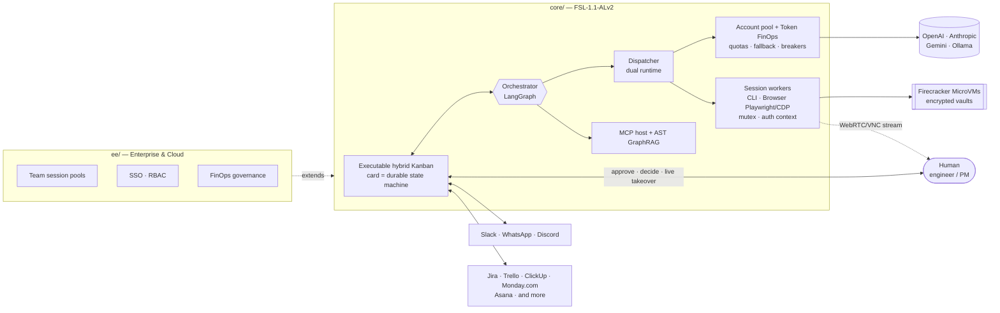

# Tradvia

**The open-core AgentOps & hybrid execution control plane.**
Orchestrate humans, multi-model APIs and isolated container sessions in a single control plane.

> 🚧 Pre-alpha, building in public. Every capability below carries its real status.
> **[Join the waitlist for the managed Cloud / Enterprise edition →](#waitlist)**
> · Website: [tradvia.org](https://tradvia.org)

[](https://codespaces.new/Tradvia/tradvia)

---

## Why

Tradvia removes the coordination friction between project management and
autonomous execution. Instead of isolated chat prompts, work is dispatched as
cards on a hybrid Kanban, routed to the right runtime — a multi-vendor API pool
or a stateful browser/CLI container — tracked to the token and the compute
second, and handed back and forth between AI agents and human engineers
without losing context.

## Architecture pillars

| # | Pillar | What it means | Status |
|---|---|---|---|
| 1 | **Dual-runtime execution** | Stateless LLM APIs (OpenAI, Anthropic, Gemini, Ollama) side by side with stateful **session workers**: containers running authenticated CLI tools or browser sessions (Playwright/CDP), guarded by session mutex locks and persistent auth contexts. | 🟦 Partial — APIs via LiteLLM |
| 2 | **Multi-account pool & Token FinOps** | Pool accounts across vendors, spread load **within each account's RPM/TPM quota**, fall back across vendors when one is saturated or down, and record exact cost per token or per compute second on the card, with budget circuit breakers. | 🟦 Partial — cost per card |
| 3 | **Executable hybrid Kanban & Live Session Takeover** | Every card is a durable state machine. On a blocker (2FA, CAPTCHA, complex UI, architecture decision) Tradvia freezes the session, alerts a human on Slack/WhatsApp and streams the terminal or browser (WebRTC/VNC) so they can resolve it and hand control back. | 🔨 In progress — state machine + approval in chat |
| 4 | **Zero-trust sandbox** | Ephemeral Firecracker MicroVMs per execution and session, PostgreSQL Row-Level Security, encrypted credential and session vaults. | 🗓️ Planned |
| 5 | **Native MCP & AST GraphRAG** | Plug-and-play MCP tools; AST-based code indexing with episodic knowledge distillation to cut token cost over time. | 🗓️ Planned |
| 6 | **Open-core monorepo** | Self-hosted `/core` via Docker Compose; `/ee` + Cloud with team session pools, RBAC and FinOps governance. | 🔨 In progress — monorepo, licenses, CI |

**Ground rules.** The account pool respects each vendor's rate limits and
terms; it never tries to bypass them. Session workers only operate accounts
and portals the customer is authorized to use, and 2FA or CAPTCHA prompts are
always resolved by a human through Live Session Takeover.

See [ADR 0003](docs/adr/0003-agentops-hybrid-execution-control-plane.md).

**Review, merge and deploy from the dashboard** (ADR 0007): the card shows the
pull request (executor summary and cost, changed files with a per-file diff,
the `core-tests`, `license-boundary` and `cla` checks, review comments), and a
maintainer can squash-merge it, update its branch, approve or reject pending
`production` deploys, cancel replaced ones and run the post-deploy operation,
always with their own GitHub token and an audit entry. Status: 🟦 Partial,
tested offline; it works in production once the GitHub App has the new
permissions ([docs/github-app.md](docs/github-app.md)).

## Architecture



### Card lifecycle

| Status | Who acts | What happens |
|---|---|---|
| `BACKLOG` | Human | Card created and prioritized |
| `AGENT_WORKING` | Agents | Dispatched to an API runtime or a session worker |
| `WAITING_HUMAN` | Human | Approval gate in chat, or a frozen session waiting for live takeover |
| `IN_REVIEW_PR` | Human + Reviewer | Pull request open, checks running |
| `DONE` | — | Delivered; tokens, compute seconds and time recorded on the card |

The contract is in
[`core/contracts/card-state.v1.json`](core/contracts/card-state.v1.json).

## What runs today (v0.1)

- LangGraph orchestrator with the card state machine and an approval gate in
  chat (Discord) before opening a pull request — [PR #1](https://github.com/tradvia/tradvia/pull/1).
- LiteLLM API runtime with cost recorded on each card.
- A neutral work model with Kanban, Gantt, Burndown, WBS, calendar and
  capacity projections, plus the `TrackerConnector` interface —
  [PR #2](https://github.com/tradvia/tradvia/pull/2).

## Develop with us — and with Tradvia

Open the dev workspace in Codespaces (badge above) or a local Dev Container and
run `make test`. Tradvia already works on its own issues: a maintainer labels an
issue `agent:ready`, the agent posts a plan as a comment, a maintainer approves
it in the thread, and the agent opens the pull request. See
[docs/dev-environment.md](docs/dev-environment.md).

## Roadmap

- [x] **Phase 0 — Foundation:** open-core monorepo, CLA, CI, card contract
- [ ] **Phase 1 — Engine v0.1:** orchestrator, LiteLLM API runtime, GitHub,
      approval gates in chat *(in progress)*
- [ ] **Phase 2 — Session workers & takeover:** browser/CLI workers in
      Firecracker MicroVMs with session mutex, live takeover over WebRTC,
      multi-account pool with budget breakers, MCP, Docker Compose
- [ ] **Phase 3 — Enterprise & Cloud:** team session pools, SSO/RBAC,
      WhatsApp and Teams, AST GraphRAG with distillation, FinOps governance,
      project-tool connectors

## Repository layout

```
.
├── core/            # Community edition — FSL-1.1-ALv2
│   ├── contracts/           # Card state contract and schemas
│   └── src/tradvia/
│       ├── graph.py     # LangGraph orchestrator (card state machine)
│       └── work/        # Work model, projections, connector interface
├── ee/              # Enterprise Edition — commercial license
│   ├── auth/sso/
│   └── integrations/{whatsapp,teams}/
├── docs/adr/        # Architecture decision records
├── scripts/         # Repository tooling
└── .github/         # CI, templates, rulesets, CODEOWNERS
```

**One rule:** `core/` never depends on `ee/`. CI enforces it.

## Waitlist

Don't want to run Docker, session workers, MCP servers and API keys yourself?
The managed Cloud version, with team session pools, is coming. **Waitlist link: coming soon.**

## Contributing

Good first contributions: project-tool connectors (one shared
`TrackerConnector` interface), MCP servers and session-worker drivers. Read
[CONTRIBUTING.md](CONTRIBUTING.md); every contributor signs the
[CLA](CLA.md) once, through a bot on the first pull request.

## Security

Please do not open public issues for vulnerabilities. See [SECURITY.md](SECURITY.md).

## License

Tradvia is **fair source**, not OSI open source. See
[LICENSE.md](LICENSE.md). "Tradvia" is a trademark of Anderson dos Santos Dutra; see
[TRADEMARKS.md](TRADEMARKS.md).
