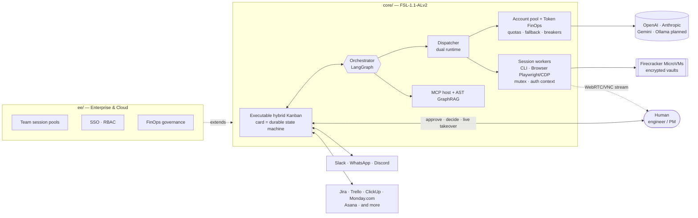

<!-- tradvia-translation source="README.md" source-sha256="9dfff189141d2fc4b38de24e316d70e3565af9718bd626211503dd53af0be4df" -->
# Tradvia

**El plano de control open-core de AgentOps y ejecución híbrida.**
Orquesta personas, APIs de varios modelos y sesiones aisladas en contenedores en un único plano de control.

> 🚧 Pre-alfa, construido en público. Cada funcionalidad de abajo lleva su estado real.
> **[Únete a la lista de espera de la edición gestionada Cloud / Enterprise →](#lista-de-espera)**
> · Sitio web: [tradvia.org](https://tradvia.org)

[](https://codespaces.new/Tradvia/tradvia)

---

## Por qué

Tradvia elimina la fricción de coordinación entre la gestión de proyectos y la
ejecución autónoma. En lugar de prompts de chat aislados, el trabajo se despacha como
cards en un Kanban híbrido, se envía al runtime adecuado — un pool de APIs de varios proveedores
o un contenedor de navegador/CLI con estado —, se sigue hasta el token y el segundo
de cómputo, y pasa de un lado a otro entre agentes de IA e ingenieros
sin perder el contexto.

## Pilares de la arquitectura

| # | Pilar | Qué significa | Estado |
|---|---|---|---|
| 1 | **Ejecución en dos runtimes** | APIs de LLM sin estado (OpenAI, Anthropic, Gemini; Ollama está 🗓️ Planned) junto a **session workers** con estado: contenedores que ejecutan herramientas de CLI autenticadas o sesiones de navegador (Playwright/CDP), protegidos por mutex de sesión y contextos de autenticación persistentes. | 🟦 Partial — APIs vía LiteLLM |
| 2 | **Pool de varias cuentas y Token FinOps** | Agrupa cuentas de varios proveedores, reparte la carga **dentro de la cuota de RPM/TPM de cada cuenta**, recurre a otro proveedor cuando uno está saturado o caído, y registra el costo exacto por token o por segundo de cómputo en el card, con disyuntores de presupuesto. | 🟦 Partial — costo por card, presupuestos de ejecución por card |
| 3 | **Kanban híbrido ejecutable y Live Session Takeover** | Cada card es una máquina de estados duradera. Ante un bloqueo (2FA, CAPTCHA, interfaz compleja, decisión de arquitectura), Tradvia congela la sesión, avisa a una persona en Slack/WhatsApp y transmite el terminal o el navegador (WebRTC/VNC) para que lo resuelva y devuelva el control. | 🔨 In progress — máquina de estados + aprobación en el chat; 🟦 Partial — un agente puede pedir una persona (`request_human`) y la persona responde "hecho"; transmitir la sesión está Planned |
| 4 | **Sandbox zero-trust** | MicroVMs Firecracker efímeras por ejecución y sesión, Row-Level Security en PostgreSQL, bóvedas cifradas de credenciales y sesiones. | 🗓️ Planned |
| 5 | **MCP nativo y AST GraphRAG** | Herramientas MCP plug-and-play; indexación de código basada en AST con destilación de conocimiento episódico para bajar el costo de tokens con el tiempo. | 🔨 In progress — MCP para agentes (stdio y HTTP), probado offline; AST GraphRAG 🗓️ Planned ([docs/mcp.md](docs/mcp.md)) |
| 6 | **Monorepo open-core** | `/core` autoalojado con Docker Compose; `/ee` + Cloud con pools de sesión por equipo, RBAC y gobernanza de FinOps. | 🔨 In progress — monorepo, licencias, CI |

**Reglas básicas.** El pool de cuentas respeta los límites de uso y los
términos de cada proveedor; nunca intenta eludirlos. Los session workers solo operan cuentas
y portales que el cliente está autorizado a usar, y los pedidos de 2FA o CAPTCHA
siempre los resuelve una persona con el Live Session Takeover.

Ver la [ADR 0003](docs/adr/0003-agentops-hybrid-execution-control-plane.md).

**Revisar, hacer merge y deploy desde el panel** (ADR 0007): el card muestra el
pull request (resumen y costo del executor, archivos modificados con el diff de cada archivo,
los checks `core-tests`, `license-boundary` y `cla`, comentarios de revisión), y un
mantenedor puede hacer squash-merge, actualizar su branch, aprobar o rechazar deploys pendientes de
`production`, cancelar los reemplazados y ejecutar la operación posterior al deploy,
siempre con su propio token de GitHub y un registro de auditoría. Estado: 🟦 Partial,
probado offline; funciona en producción cuando la GitHub App tenga los nuevos
permisos ([docs/github-app.md](docs/github-app.md)).

**Conversación con el orquestador** (ADR 0007): cada proyecto tiene un chat en el
panel donde un agente orquestador lee el backlog, los cards, los planes, los pull
requests, los checks y los deploys, crea y edita cards, ordena el backlog,
inicia cards, responde planes con un ajuste y revisa pull requests
(`make check` en el branch). Nunca aprueba un plan, hace merge ni deploy:
eso se convierte en un pendiente con un botón para la persona. Presupuesto por mensaje,
registro de costos y una entrada de auditoría por herramienta. Estado: 🟦 Partial, probado offline
con un modelo con guion; ver [docs/orchestrator.md](docs/orchestrator.md).

**Consulta y exportación de la auditoría** (ADR 0008): `GET /api/projects/{owner}/{repo}/audit`
lista el registro de auditoría de un proyecto por período, con paginación, y lo exporta como CSV o JSON
Lines (`format=csv|jsonl`), con las mismas reglas de rol que la auditoría por card y
los secretos ocultos. Estado: 🟦 Partial, probado offline con el store en memoria; la
consulta en Postgres aún no la ejercitan las pruebas offline.

**Documentación en el panel:** estado de las funcionalidades, una guía paso a paso y
enlaces técnicos en `/runs/docs.html` (`dashboard/docs.html`), accesible desde el
enlace "Ayuda" del encabezado. Estado: ✅ Shipped.

**Agentes de código** ([docs/coding-agents.md](docs/coding-agents.md), ADR 0010): el planner
y el executor de un card son un adaptador (Claude Code ✅ Shipped; Gemini CLI y Codex CLI
🟨 In progress, probados offline con ejecutores simulados). Las herramientas de IDE sin CLI no interactiva están
⏳ Planned.

**Trazas distribuidas** (ADR 0017): una traza OpenTelemetry por card, con un span por nodo del grafo,
ejecución de modelo y llamada a herramienta del executor. Opcional: `pip install tradvia[otel]`, luego define
`TRADVIA_OTEL=1` y las variables estándar `OTEL_EXPORTER_OTLP_*` (por ejemplo
`OTEL_EXPORTER_OTLP_ENDPOINT`). Todo pasa por `redact` antes de exportarse; sin
el extra nada cambia. Estado: 🟦 Partial, probado offline con un exportador en memoria;
aún no verificado contra un colector real.

**Bandeja de pendientes y Web Push** ([docs/notifications.md](docs/notifications.md), ADR 0020):
el panel lista, por proyecto, los cards que te esperan según tu rol (plan listo, pregunta
del agente, PR abierto, límite de presupuesto o de ajustes) con un contador en el encabezado, y puede
enviar una notificación al navegador o al teléfono (VAPID, sin servicio de pago) que lleva solo el
proyecto, el número del card y el tipo de evento. Estado: ✅ Shipped, probado offline;
Web Push necesita las dos claves VAPID en el servidor. Slack, WhatsApp y correo: 🗓️ Planned.

**Conexiones por proyecto** (ADR 0019): un admin elige el proveedor y el modelo del
planner, el executor, el reviewer y el orquestador en la pantalla "Conexiones" y
guarda allí los secretos de los proveedores. Los secretos se cifran en Postgres con una clave
derivada de `TRADVIA_SECRET_KEY`, nunca se devuelven al navegador y se escriben como
secretos de repositorio de GitHub Actions al guardarlos. La sección opcional `providers` de
`.tradvia.yml` es el valor por defecto; lo que se define en Tradvia la reemplaza, y la pantalla
muestra el origen de cada valor. Estado: 🟦 Partial, probado offline. Por proveedor:

| Proveedor | Estado |
|---|---|
| GitHub | ✅ Shipped (inicio de sesión y acciones); los secretos de Actions necesitan el permiso *Secrets* |
| Anthropic / Claude Code | 🟦 Partial (el planner y `claude.yml` lo usan; los workflows aún no leen la elección por rol) |
| Google Gemini | 🔨 In progress (secreto y modelo guardados y entregados; ningún executor los usa todavía) |
| OpenAI | 🔨 In progress (igual que Gemini) |
| GitLab | 🗓️ Planned ([#60](https://github.com/tradvia/tradvia/issues/60)) |
| Bitbucket | 🗓️ Planned, backlog; no empieza hasta que el dueño lo decida ([#173](https://github.com/tradvia/tradvia/issues/173)) |

## Arquitectura



### Ciclo de vida del card

| Estado | Quién actúa | Qué pasa |
|---|---|---|
| `BACKLOG` | Persona | Card creado y priorizado |
| `AGENT_WORKING` | Agentes | Despachado a un runtime de API o a un session worker |
| `WAITING_HUMAN` | Persona | Punto de aprobación en el chat, o una sesión congelada esperando el live takeover |
| `IN_REVIEW_PR` | Persona + Reviewer | Pull request abierto, checks en curso |
| `DONE` | — | Entregado; tokens, segundos de cómputo y tiempo registrados en el card |

El contrato está en
[`core/contracts/card-state.v1.json`](core/contracts/card-state.v1.json).

## Qué funciona hoy (v0.1)

- Orquestador LangGraph con la máquina de estados del card y un punto de aprobación en el
  chat (Discord) antes de abrir un pull request — [PR #1](https://github.com/tradvia/tradvia/pull/1).
- Runtime de API con LiteLLM, con el costo registrado en cada card.
- Un modelo de trabajo neutral con proyecciones de Kanban, Gantt, Burndown, WBS, calendario y
  capacidad, más la interfaz `TrackerConnector` —
  [PR #2](https://github.com/tradvia/tradvia/pull/2).

Los cards también se pueden crear e iniciar desde scripts o la CLI `tradvia` con tokens de
API (siempre pasando por el planner y la aprobación del plan); las tareas rápidas sin plan están
**Planned**. Ver [docs/programmatic-api.md](docs/programmatic-api.md).

## Desarrolla con nosotros — y con Tradvia

Abre el entorno de desarrollo en Codespaces (insignia de arriba) o en un Dev Container local y
ejecuta `make test`. Tradvia ya trabaja en sus propias issues: un mantenedor pone la etiqueta
`agent:ready` a una issue, el agente publica un plan como comentario, un mantenedor lo aprueba
en la conversación y el agente abre el pull request. Ver
[docs/dev-environment.md](docs/dev-environment.md).

## Hoja de ruta

- [x] **Fase 0 — Base:** monorepo open-core, CLA, CI, contrato del card
- [ ] **Fase 1 — Motor v0.1:** orquestador, runtime de API LiteLLM, GitHub,
      puntos de aprobación en el chat *(en curso)*
      Etapa de robustez *(en curso)*: guardrails de comandos, credenciales y datos
      personales en cards y pull requests, solo con regex, Partial (ADR 0015)
  - Etapa 3 (robustez) — harness de evaluación con tareas de referencia y regresión por modelo/prompt:
    **Partial** (offline con un modelo con guion vía `make evals`;
    el modelo real solo manual, `TRADVIA_EVALS_LIVE=1`)
  - Etapa 3 (robustez) — prompts versionados: **Shipped** en el código (`core/src/tradvia/prompts/`,
    una prueba falla cuando un texto cambia sin su versión; los comentarios de plan, los pull requests y
    los informes de evaluación nombran la versión, por ejemplo `Prompt: plan@1`)
  - Etapa 3 (robustez) — canary de prompt y modelo en una parte de los cards de cada proyecto, definido
    en Tradvia con reversión en un clic: **In progress** (pruebas offline; ADR 0016, ADR 0018)
  - Etapa 4 (automatización) — cards recurrentes: una programación definida en Tradvia crea un card a tiempo,
    nunca lo inicia: **In progress** (pruebas offline con un reloj simulado; en producción necesita un token del servidor con
    Issues: Read and write)
- [ ] **Fase 2 — Session workers y takeover:** workers de navegador/CLI en
      MicroVMs Firecracker con mutex de sesión, live takeover por WebRTC,
      pool de varias cuentas con disyuntores de presupuesto, MCP, Docker Compose
- [ ] **Fase 3 — Enterprise y Cloud:** pools de sesión por equipo, SSO/RBAC,
      WhatsApp y Teams, AST GraphRAG con destilación, gobernanza de FinOps,
      conectores de herramientas de proyecto

## Organización del repositorio

```
.
├── core/            # Community edition — FSL-1.1-ALv2
│   ├── contracts/           # Card state contract and schemas
│   └── src/tradvia/
│       ├── graph.py     # LangGraph orchestrator (card state machine)
│       └── work/        # Work model, projections, connector interface
├── ee/              # Enterprise Edition — commercial license
│   ├── auth/sso/
│   └── integrations/{whatsapp,teams}/
├── docs/adr/        # Architecture decision records
├── scripts/         # Repository tooling
└── .github/         # CI, templates, rulesets, CODEOWNERS
```

**Una regla:** `core/` nunca depende de `ee/`. El CI lo garantiza.

## Lista de espera

¿No quieres ejecutar Docker, session workers, servidores MCP y claves de API por tu cuenta?
La versión Cloud gestionada, con pools de sesión por equipo, está en camino. **Enlace a la lista de espera: pronto.**

## Contribuir

Buenas primeras contribuciones: conectores de herramientas de proyecto (una interfaz
`TrackerConnector` compartida), servidores MCP y drivers de session worker. Lee el
[CONTRIBUTING.md](CONTRIBUTING.md); cada persona que contribuye firma el
[CLA](CLA.md) una vez, mediante un bot en su primer pull request.

## Seguridad

Por favor, no abras issues públicas para vulnerabilidades. Ver [SECURITY.md](SECURITY.md).

## Licencia

Tradvia es **fair source**, no open source según la OSI. Ver
[LICENSE.md](LICENSE.md). "Tradvia" es una marca de Anderson dos Santos Dutra; ver
[TRADEMARKS.md](TRADEMARKS.md).
