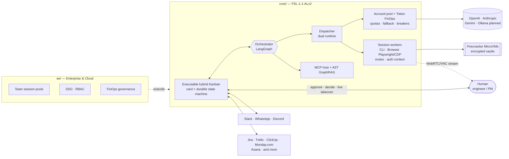

<!-- tradvia-translation source="README.md" source-sha256="9dfff189141d2fc4b38de24e316d70e3565af9718bd626211503dd53af0be4df" -->
# Tradvia

**O plano de controle open-core de AgentOps e execução híbrida.**
Orquestre pessoas, APIs de vários modelos e sessões isoladas em containers num único plano de controle.

> 🚧 Pré-alfa, construído em público. Cada funcionalidade abaixo traz o seu status real.
> **[Entre na lista de espera da edição gerenciada Cloud / Enterprise →](#lista-de-espera)**
> · Site: [tradvia.org](https://tradvia.org)

[](https://codespaces.new/Tradvia/tradvia)

---

## Por quê

O Tradvia remove o atrito de coordenação entre a gestão de projetos e a
execução autônoma. Em vez de prompts de chat isolados, o trabalho é despachado como
cards num Kanban híbrido, encaminhado para o runtime certo — um pool de APIs de vários fornecedores
ou um container de navegador/CLI com estado —, acompanhado até o token e o segundo
de computação, e passado de um lado para o outro entre agentes de IA e engenheiros
sem perder o contexto.

## Pilares da arquitetura

| # | Pilar | O que significa | Status |
|---|---|---|---|
| 1 | **Execução em dois runtimes** | APIs de LLM sem estado (OpenAI, Anthropic, Gemini; Ollama está 🗓️ Planned) lado a lado com **session workers** com estado: containers rodando ferramentas de CLI autenticadas ou sessões de navegador (Playwright/CDP), protegidos por mutex de sessão e contextos de autenticação persistentes. | 🟦 Partial — APIs via LiteLLM |
| 2 | **Pool de várias contas e Token FinOps** | Junta contas de vários fornecedores, distribui a carga **dentro da cota de RPM/TPM de cada conta**, recorre a outro fornecedor quando um está saturado ou fora do ar, e registra o custo exato por token ou por segundo de computação no card, com disjuntores de orçamento. | 🟦 Partial — custo por card, orçamentos de execução por card |
| 3 | **Kanban híbrido executável e Live Session Takeover** | Cada card é uma máquina de estados durável. Diante de um bloqueio (2FA, CAPTCHA, interface complexa, decisão de arquitetura), o Tradvia congela a sessão, alerta uma pessoa no Slack/WhatsApp e transmite o terminal ou o navegador (WebRTC/VNC) para que ela resolva e devolva o controle. | 🔨 In progress — máquina de estados + aprovação no chat; 🟦 Partial — um agente pode pedir uma pessoa (`request_human`) e a pessoa responde "feito"; transmitir a sessão está Planned |
| 4 | **Sandbox zero-trust** | MicroVMs Firecracker efêmeras por execução e sessão, Row-Level Security no PostgreSQL, cofres criptografados de credenciais e sessões. | 🗓️ Planned |
| 5 | **MCP nativo e AST GraphRAG** | Ferramentas MCP plug-and-play; indexação de código baseada em AST com destilação de conhecimento episódico para reduzir o custo de tokens com o tempo. | 🔨 In progress — MCP para agentes (stdio e HTTP), testado offline; AST GraphRAG 🗓️ Planned ([docs/mcp.md](docs/mcp.md)) |
| 6 | **Monorepo open-core** | `/core` auto-hospedado via Docker Compose; `/ee` + Cloud com pools de sessão por equipe, RBAC e governança de FinOps. | 🔨 In progress — monorepo, licenças, CI |

**Regras básicas.** O pool de contas respeita os limites de uso e os
termos de cada fornecedor; ele nunca tenta contorná-los. Os session workers só operam contas
e portais que o cliente está autorizado a usar, e pedidos de 2FA ou CAPTCHA são
sempre resolvidos por uma pessoa pelo Live Session Takeover.

Veja a [ADR 0003](docs/adr/0003-agentops-hybrid-execution-control-plane.md).

**Revisar, fazer merge e deploy pelo painel** (ADR 0007): o card mostra o
pull request (resumo e custo do executor, arquivos alterados com o diff de cada arquivo,
os checks `core-tests`, `license-boundary` e `cla`, comentários de revisão), e um
mantenedor pode fazer squash-merge, atualizar o branch, aprovar ou rejeitar deploys pendentes de
`production`, cancelar os substituídos e rodar a operação pós-deploy,
sempre com o próprio token do GitHub e um registro de auditoria. Status: 🟦 Partial,
testado offline; funciona em produção quando o GitHub App tiver as novas
permissões ([docs/github-app.md](docs/github-app.md)).

**Conversa com o orquestrador** (ADR 0007): cada projeto tem um chat no
painel em que um agente orquestrador lê o backlog, os cards, os planos, os pull
requests, os checks e os deploys, cria e edita cards, ordena o backlog,
inicia cards, responde planos com um ajuste e revisa pull requests
(`make check` no branch). Ele nunca aprova um plano, faz merge ou deploy:
isso vira uma pendência com um botão para a pessoa. Orçamento por mensagem,
registro de custo e uma entrada de auditoria por ferramenta. Status: 🟦 Partial, testado offline
com um modelo roteirizado; veja [docs/orchestrator.md](docs/orchestrator.md).

**Consulta e exportação da auditoria** (ADR 0008): `GET /api/projects/{owner}/{repo}/audit`
lista o registro de auditoria de um projeto por período, com paginação, e o exporta como CSV ou JSON
Lines (`format=csv|jsonl`), com as mesmas regras de papel da auditoria por card e
os segredos ocultados. Status: 🟦 Partial, testado offline com o store em memória; a
consulta no Postgres ainda não é exercitada pelos testes offline.

**Documentação no painel:** status das funcionalidades, um guia passo a passo e
links técnicos em `/runs/docs.html` (`dashboard/docs.html`), acessível pelo
link "Ajuda" do cabeçalho. Status: ✅ Shipped.

**Agentes de código** ([docs/coding-agents.md](docs/coding-agents.md), ADR 0010): o planner
e o executor de um card são um adaptador (Claude Code ✅ Shipped; Gemini CLI e Codex CLI
🟨 In progress, testados offline com executores simulados). Ferramentas de IDE sem CLI não interativa estão
⏳ Planned.

**Rastreamento distribuído** (ADR 0017): um trace OpenTelemetry por card, com um span por nó do grafo,
execução de modelo e chamada de ferramenta do executor. Opcional: `pip install tradvia[otel]`, depois defina
`TRADVIA_OTEL=1` e as variáveis padrão `OTEL_EXPORTER_OTLP_*` (por exemplo
`OTEL_EXPORTER_OTLP_ENDPOINT`). Tudo passa por `redact` antes da exportação; sem
o extra nada muda. Status: 🟦 Partial, testado offline com um exportador em memória;
ainda não verificado contra um coletor real.

**Caixa de pendências e Web Push** ([docs/notifications.md](docs/notifications.md), ADR 0020):
o painel lista, por projeto, os cards que esperam por você conforme o papel (plano pronto, pergunta
do agente, PR aberto, limite de orçamento ou de ajustes) com um contador no cabeçalho, e pode
enviar uma notificação para o navegador ou o celular (VAPID, sem serviço pago) que leva só o
projeto, o número do card e o tipo de evento. Status: ✅ Shipped, testado offline;
o Web Push precisa das duas chaves VAPID no servidor. Slack, WhatsApp e e-mail: 🗓️ Planned.

**Conexões por projeto** (ADR 0019): um admin escolhe o provedor e o modelo do
planner, do executor, do reviewer e do orquestrador na tela "Conexões" e
guarda ali os segredos dos provedores. Os segredos são criptografados no Postgres com uma chave
derivada de `TRADVIA_SECRET_KEY`, nunca são devolvidos ao navegador e são gravados como
segredos de repositório do GitHub Actions ao salvar. A seção opcional `providers` do
`.tradvia.yml` é o padrão; o que é definido no Tradvia a substitui, e a tela
mostra a origem de cada valor. Status: 🟦 Partial, testado offline. Por provedor:

| Provedor | Status |
|---|---|
| GitHub | ✅ Shipped (login e ações); os segredos do Actions precisam da permissão *Secrets* |
| Anthropic / Claude Code | 🟦 Partial (o planner e o `claude.yml` usam; a escolha por papel ainda não é lida pelos workflows) |
| Google Gemini | 🔨 In progress (segredo e modelo guardados e entregues; nenhum executor os usa ainda) |
| OpenAI | 🔨 In progress (o mesmo que o Gemini) |
| GitLab | 🗓️ Planned ([#60](https://github.com/tradvia/tradvia/issues/60)) |
| Bitbucket | 🗓️ Planned, backlog; não começa até o dono decidir ([#173](https://github.com/tradvia/tradvia/issues/173)) |

## Arquitetura



### Ciclo de vida do card

| Status | Quem age | O que acontece |
|---|---|---|
| `BACKLOG` | Pessoa | Card criado e priorizado |
| `AGENT_WORKING` | Agentes | Despachado para um runtime de API ou um session worker |
| `WAITING_HUMAN` | Pessoa | Ponto de aprovação no chat, ou uma sessão congelada esperando o live takeover |
| `IN_REVIEW_PR` | Pessoa + Reviewer | Pull request aberto, checks rodando |
| `DONE` | — | Entregue; tokens, segundos de computação e tempo registrados no card |

O contrato está em
[`core/contracts/card-state.v1.json`](core/contracts/card-state.v1.json).

## O que roda hoje (v0.1)

- Orquestrador LangGraph com a máquina de estados do card e um ponto de aprovação no
  chat (Discord) antes de abrir um pull request — [PR #1](https://github.com/tradvia/tradvia/pull/1).
- Runtime de API com LiteLLM, com o custo registrado em cada card.
- Um modelo de trabalho neutro com projeções de Kanban, Gantt, Burndown, WBS, calendário e
  capacidade, além da interface `TrackerConnector` —
  [PR #2](https://github.com/tradvia/tradvia/pull/2).

Cards também podem ser criados e iniciados por scripts ou pela CLI `tradvia` com tokens de
API (ainda passando pelo planner e pela aprovação do plano); tarefas rápidas sem plano estão
**Planned**. Veja [docs/programmatic-api.md](docs/programmatic-api.md).

## Desenvolva com a gente — e com o Tradvia

Abra o ambiente de desenvolvimento no Codespaces (selo acima) ou num Dev Container local e
rode `make test`. O Tradvia já trabalha nas próprias issues: um mantenedor marca uma
issue com `agent:ready`, o agente posta um plano como comentário, um mantenedor aprova
na conversa e o agente abre o pull request. Veja
[docs/dev-environment.md](docs/dev-environment.md).

## Roadmap

- [x] **Fase 0 — Fundação:** monorepo open-core, CLA, CI, contrato do card
- [ ] **Fase 1 — Motor v0.1:** orquestrador, runtime de API LiteLLM, GitHub,
      pontos de aprovação no chat *(em andamento)*
      Etapa de robustez *(em andamento)*: guardrails de comandos, credenciais e dados
      pessoais em cards e pull requests, só com regex, Partial (ADR 0015)
  - Etapa 3 (robustez) — harness de avaliação com tarefas de referência e regressão por modelo/prompt:
    **Partial** (offline com um modelo roteirizado via `make evals`;
    modelo real só manual, `TRADVIA_EVALS_LIVE=1`)
  - Etapa 3 (robustez) — prompts versionados: **Shipped** no código (`core/src/tradvia/prompts/`,
    um teste falha quando um texto muda sem a versão; comentários de plano, pull requests e
    relatórios de avaliação citam a versão, por exemplo `Prompt: plan@1`)
  - Etapa 3 (robustez) — canary de prompt e modelo numa parte dos cards de cada projeto, definido
    no Tradvia, com reversão em um clique: **In progress** (testes offline; ADR 0016, ADR 0018)
  - Etapa 4 (automação) — cards recorrentes: um agendamento definido no Tradvia cria um card na hora,
    sem iniciá-lo: **In progress** (testes offline com relógio simulado; em produção precisa de um token do servidor com
    Issues: Read and write)
- [ ] **Fase 2 — Session workers e takeover:** workers de navegador/CLI em
      MicroVMs Firecracker com mutex de sessão, live takeover por WebRTC,
      pool de várias contas com disjuntores de orçamento, MCP, Docker Compose
- [ ] **Fase 3 — Enterprise e Cloud:** pools de sessão por equipe, SSO/RBAC,
      WhatsApp e Teams, AST GraphRAG com destilação, governança de FinOps,
      conectores de ferramentas de projeto

## Organização do repositório

```
.
├── core/            # Community edition — FSL-1.1-ALv2
│   ├── contracts/           # Card state contract and schemas
│   └── src/tradvia/
│       ├── graph.py     # LangGraph orchestrator (card state machine)
│       └── work/        # Work model, projections, connector interface
├── ee/              # Enterprise Edition — commercial license
│   ├── auth/sso/
│   └── integrations/{whatsapp,teams}/
├── docs/adr/        # Architecture decision records
├── scripts/         # Repository tooling
└── .github/         # CI, templates, rulesets, CODEOWNERS
```

**Uma regra:** `core/` nunca depende de `ee/`. O CI garante isso.

## Lista de espera

Não quer rodar Docker, session workers, servidores MCP e chaves de API por conta própria?
A versão Cloud gerenciada, com pools de sessão por equipe, está a caminho. **Link da lista de espera: em breve.**

## Contribuir

Boas primeiras contribuições: conectores de ferramentas de projeto (uma interface
`TrackerConnector` compartilhada), servidores MCP e drivers de session worker. Leia o
[CONTRIBUTING.md](CONTRIBUTING.md); toda pessoa que contribui assina o
[CLA](CLA.md) uma vez, por um robô no primeiro pull request.

## Segurança

Por favor, não abra issues públicas para vulnerabilidades. Veja o [SECURITY.md](SECURITY.md).

## Licença

O Tradvia é **fair source**, não open source pela OSI. Veja o
[LICENSE.md](LICENSE.md). "Tradvia" é uma marca de Anderson dos Santos Dutra; veja
[TRADEMARKS.md](TRADEMARKS.md).
